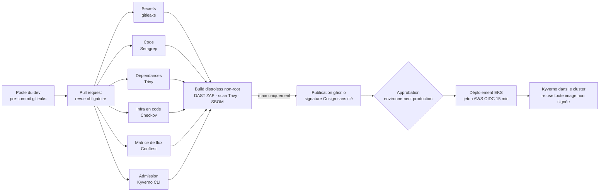

# Kalipay — démo de la chaîne CI/CD sécurisée

Démo technique du dossier d'architecture Kalipay (M2 Architecture Sécurisée, EFREI).
Elle montre en vrai la chaîne de la **zone Z6 (usine logicielle)** : chaque commit traverse
une série de contrôles, et une faille connue est bloquée **avant** d'atteindre la production.

| Ce que la démo prouve | Lien avec le dossier |
|---|---|
| Plus aucun secret dans le code, ni clé AWS permanente dans la CI | Incident de 2025, **E6**, **RQ3**, **RQ9**, flux **F10** |
| Seules des images signées par le pipeline entrent dans le cluster | Flux **M15**, livrable 13 (contrôles 4 et 5) |
| Une règle réseau absente de la matrice de flux est refusée | Risque résiduel **R1** (livrable 9), matrice de flux (livrable 7) |
| Pas de numéro de carte hors du périmètre carte | **E2**, PCI-DSS |
| Le déploiement en production demande un second approbateur | **E7** |

## Le pipeline



| # | Job | Outil | Bloque si… | Fichiers |
|---|---|---|---|---|
| 1 | Secrets | gitleaks | un secret est présent dans l'historique Git | `.gitleaks.toml`, `.pre-commit-config.yaml` |
| 2 | Code (SAST) | Semgrep | règle Python ou règle Kalipay : PAN manipulé, `verify=False`, Flask en debug | `.semgrep/kalipay.yml` |
| 3 | Dépendances (SCA) | Trivy | CVE haute ou critique corrigeable | `app/requirements.txt` |
| 4 | Infra en code | Checkov | mauvaise configuration Terraform ou Kubernetes | `infra/terraform/`, `k8s/`, `.checkov.yaml` |
| 5 | Matrice de flux | Conftest (OPA) | NetworkPolicy qui ouvre un flux absent de la matrice | `policies/flow-matrix/` |
| 6 | Admission | Kyverno CLI | conteneur root, privilégié ou sans limites | `policies/kyverno/` |
| 7 | Image | Buildx, ZAP, Trivy, Syft, Cosign | en-têtes de sécurité absents, CVE dans l'image | `Dockerfile`, `zap-rules.tsv` |
| 8 | Déploiement | OIDC AWS, kubectl | pas d'approbation, image non signée | `infra/terraform/main.tf`, `policies/kyverno/verify-images.yaml` |

### Choix de sécurité de la chaîne elle-même

La CI/CD est une cible de choix (elle déploie partout). Elle est donc durcie elle aussi :

- **Actions épinglées par SHA de commit**, pas par étiquette : une étiquette déplacée par un
  attaquant ne peut pas injecter de code dans le pipeline.
- **Outils téléchargés avec vérification SHA-256** (gitleaks, Trivy, Conftest, Kyverno).
- **Droits minimaux** : `contents: read` par défaut ; seul le job image peut publier et signer.
- **Aucun secret stocké** : la signature Cosign et l'accès AWS utilisent le jeton OIDC
  de GitHub, valable quelques minutes. Le rôle AWS n'accepte que l'environnement `production`
  du dépôt (`infra/terraform/main.tf`).
- **Image référencée par digest**, jamais par tag : ce qui est déployé est exactement ce
  qui a été scanné et signé.
- **Exceptions Checkov justifiées dans le code** (`#checkov:skip=…:raison`), donc relues en PR.

## Démo pour la soutenance

Chaque scénario introduit une faille réaliste. On pousse la branche, on ouvre une PR, et on
montre le job qui passe au rouge.

```bash
./demo/casser.sh secret   # clé d'API partenaire en dur      → Secrets (gitleaks)
./demo/casser.sh pan      # route qui manipule un n° de carte → Code (Semgrep)
./demo/casser.sh cve      # PyYAML 5.3.1 (CVE-2020-14343)    → Dépendances (Trivy)
./demo/casser.sh iac      # SSH ouvert à 0.0.0.0/0           → Infra en code (Checkov)
./demo/casser.sh flux     # recette Z3 → production (M22)    → Matrice de flux (Conftest)
./demo/casser.sh root     # conteneur root + escalade        → Kyverno et Checkov
```

Puis :

```bash
git checkout -b demo/secret && git add -A && git commit -m "demo: secret" && git push -u origin demo/secret
```

Pour revenir à l'état sain : `git checkout -- . && git clean -fd app k8s infra`.

Sans GitHub, `./demo/verifier-local.sh` lance les six premiers contrôles en local
(il faut gitleaks, semgrep, trivy, checkov, conftest et kyverno dans le `PATH`).

## Mise en route sur GitHub

1. Créer le dépôt et pousser `main`.
2. *Settings → Branches* : protéger `main` (PR obligatoire, 1 revue, jobs 1 à 6 requis).
3. *Settings → Environments* : créer `production` avec un *required reviewer*.
4. Dans `policies/kyverno/verify-images.yaml`, remplacer `OWNER` par le compte GitHub.
5. Facultatif, pour le déploiement réel : appliquer `infra/terraform` sur un compte AWS de
   test, puis créer la variable de dépôt `AWS_ROLE_ARN`. Sans elle, le job de déploiement
   est simplement ignoré.

## Arborescence

```
app/                    service « comptes » (Flask), ne manipule que des jetons
Dockerfile              build multi-étapes, image distroless, utilisateur 65532
k8s/                    namespaces, Deployment durci, NetworkPolicies (deny par défaut)
infra/terraform/        rôle OIDC de la CI, bucket des rapports chiffré et verrouillé
policies/flow-matrix/   extrait de la matrice de flux + règle OPA qui la fait respecter
policies/kyverno/       politiques d'admission (CEL) et leurs tests
.semgrep/               règles SAST propres à Kalipay
demo/                   scénarios de faille et vérification locale
```

## Limites de la démo

- Un seul cluster et un seul service : la démo illustre Z1 et Z4. Pour la colocation,
  le dossier prévoit le même pipeline, avec un registre miroir (Harbor) en colocation et
  ArgoCD qui *tire* les images signées dans Z5 et Z9. Le cloud n'a ainsi aucun accès entrant
  au périmètre carte. Cette partie n'est pas implémentée ici.
- Les flux de la matrice sont simplifiés pour tenir dans un cluster (M12 en particulier).
- Le build, le DAST, la signature et le déploiement demandent GitHub Actions et Docker. Ils
  n'ont pas été exécutés en local, contrairement aux six premiers contrôles.
